<div align="center">


<br/>

# SonamOS

### A portfolio you don't scroll — you *boot*.

A fully interactive macOS-style desktop in the browser. Open folders, launch apps from the dock, and explore my projects, skills and story the way you'd explore a real Mac.

<br/>

[](https://sonamnarula.dev)
[](https://github.com/SonamNarula/macos_portfolio/stargazers)
[](https://github.com/SonamNarula/macos_portfolio/network/members)
[](https://github.com/SonamNarula/macos_portfolio/issues)


</div>

---

## Table of Contents

- [About](#about)
- [Preview](#preview)
- [What's Inside](#whats-inside)
- [How It Works](#how-it-works)
- [Explore the Apps](#explore-the-apps)
- [Projects Showcased](#projects-showcased)
- [Tech Stack](#tech-stack)
- [Getting Started](#getting-started)
- [Project Structure](#project-structure)
- [Make It Your Own](#make-it-your-own)
- [Contributing](#contributing)
- [Connect With Me](#connect-with-me)

---

## About

Hi, I'm **Sonam Narula** — a B.Tech CSE student at JECRC University (2027) who loves **DSA, competitive programming and AI/ML**, and who built a very particular kind of portfolio: one that behaves like an operating system.

> **ICPC Algo Queen 2026 · Global Rank 386**

Instead of a long landing page, **SonamOS** drops visitors onto a macOS-inspired desktop with a menu bar, a dock, desktop folders and draggable windows. Every part of me — projects, experience, resume, skills, contact details — lives inside an app you can open.

---

## Preview

<div align="center">

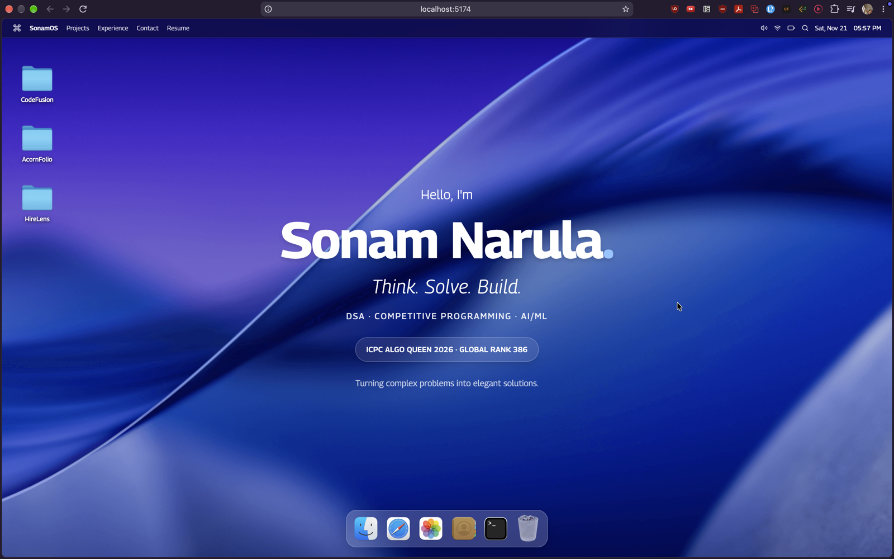

<sub>The SonamOS desktop: menu bar, desktop folders, hero and dock.</sub>

</div>

<br/>

<table>
  <tr>
    <td width="50%">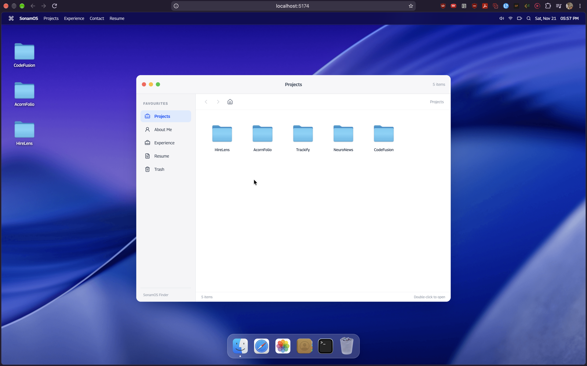<br/><sub><b>Finder</b> — Favourites sidebar and project folders</sub></td>
    <td width="50%">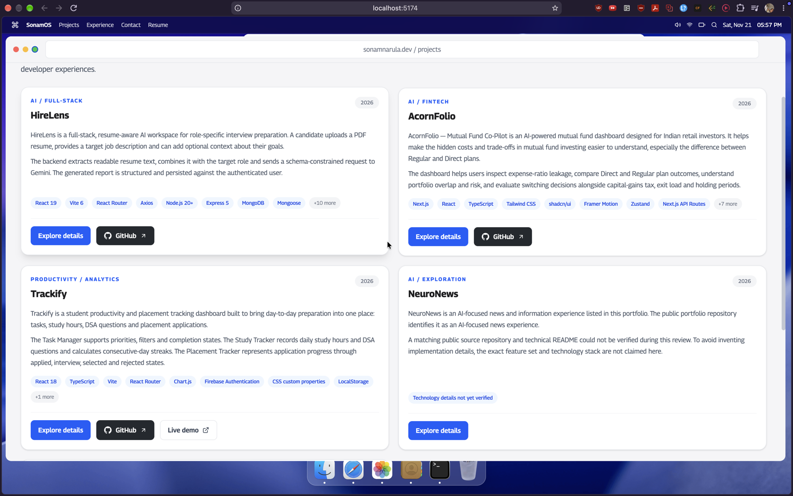<br/><sub><b>Safari</b> — maximized project showcase</sub></td>
  </tr>
  <tr>
    <td width="50%">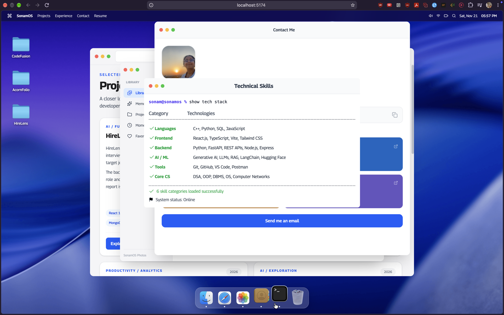<br/><sub><b>Terminal</b> — <code>show tech stack</code></sub></td>
    <td width="50%">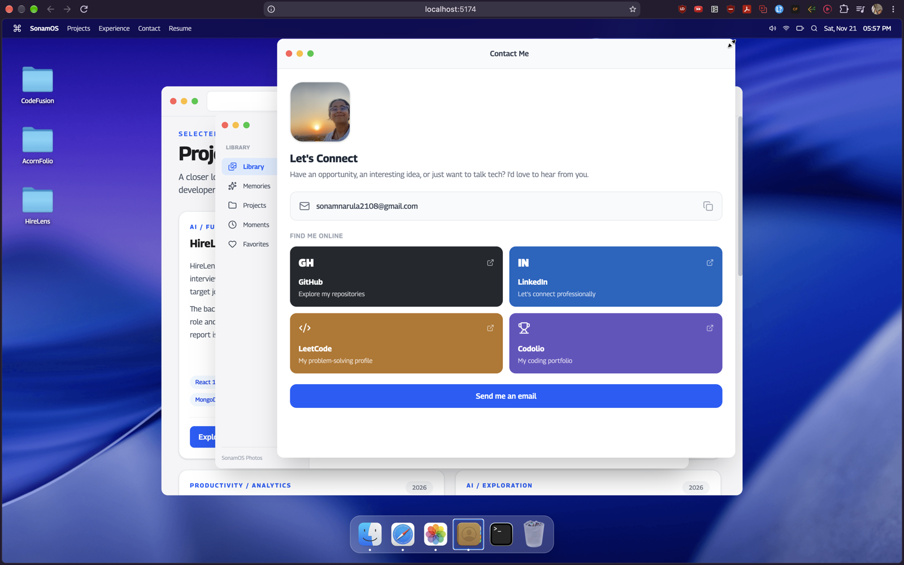<br/><sub><b>Contacts</b> — every way to reach me</sub></td>
  </tr>
  <tr>
    <td width="50%">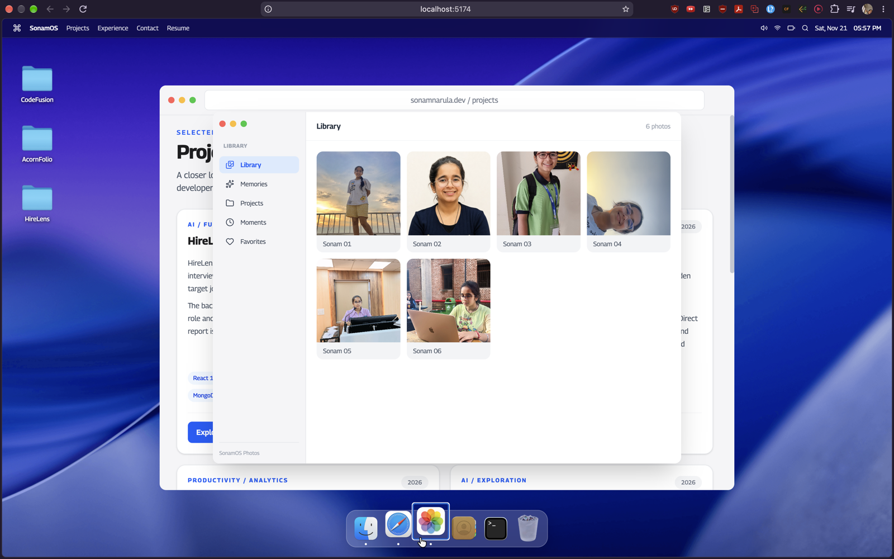<br/><sub><b>Photos</b> — a more personal side</sub></td>
    <td width="50%">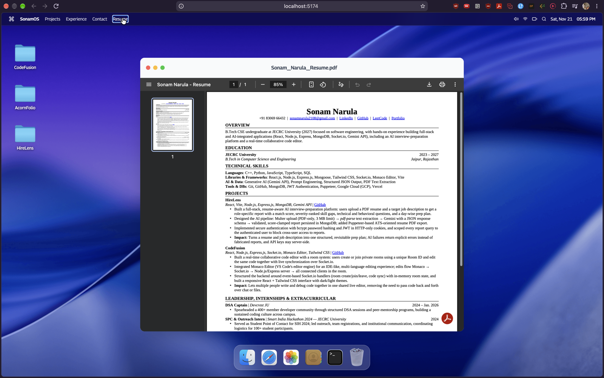<br/><sub><b>Resume</b> — built-in PDF viewer</sub></td>
  </tr>
</table>

---

## What's Inside

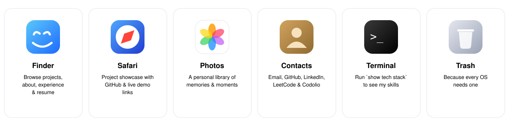

- **macOS-style menu bar** with working navigation (`Projects`, `Experience`, `Contact`, `Resume`) plus live status icons and a real-time clock
- **Dock** with Finder, Safari, Photos, Contacts, Terminal and Trash, including hover magnification and running-app indicators
- **Draggable, stackable windows** with traffic-light controls (close, minimize, maximize)
- **Desktop folders** for featured projects that open straight into a Finder window
- **Finder app** with a Favourites sidebar, back/forward/home navigation and double-click-to-open behaviour
- **Safari-style project browser** with tech-stack tags, *Explore details*, GitHub and *Live demo* buttons
- **Terminal skills view** that "runs" `show tech stack` and prints a categorized skills table
- **Contacts card** with one-click email copy and links to GitHub, LinkedIn, LeetCode and Codolio
- **Photos app** with a library, memories, projects, moments and favorites
- **Embedded resume viewer** for `Sonam_Narula_Resume.pdf` with zoom, download and print

---

## How It Works

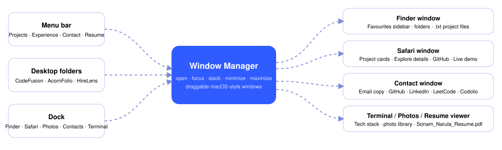

Three entry points (menu bar, desktop folders and dock) all talk to the same **window manager**, so any app can be opened, focused, stacked, minimized or maximized from anywhere.

---

## Explore the Apps

### Menu bar

The top navigation is fully functional:

| Menu item | What happens |
|-----------|--------------|
| **SonamOS** | System menu / home |
| **Projects** | Opens the Safari-style project showcase |
| **Experience** | Opens my experience (DSA Captain at Devcrest JU, SPC & Outreach Intern for SIH 2024, and more) |
| **Contact** | Opens the Contacts window |
| **Resume** | Opens the PDF resume viewer |

### Desktop folders

Double-click any folder on the desktop (**CodeFusion**, **AcornFolio**, **HireLens**) to open a Finder window.

<div align="center">
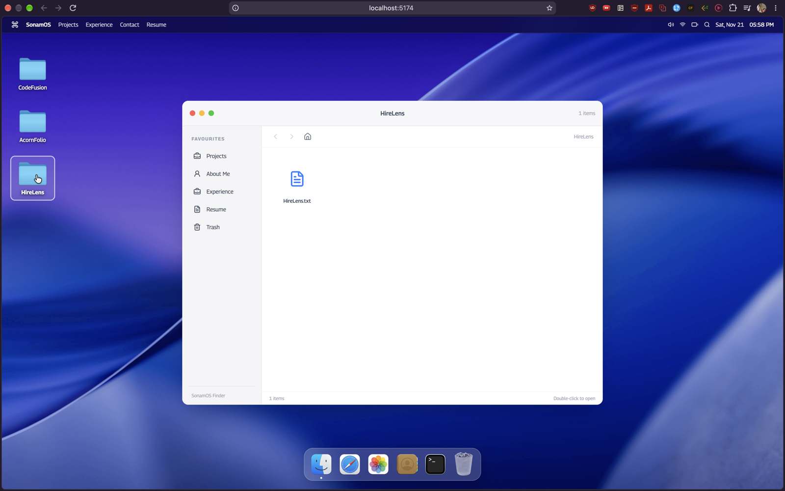
</div>

Inside each project folder you'll find a `.txt` file with:

- A description of the project
- A link to the **GitHub repository**
- A link to the **deployed app** (when it's live)

### Finder

The Finder's Favourites sidebar jumps between **Projects**, **About Me**, **Experience**, **Resume** and **Trash**. The Projects view contains five folders: HireLens, AcornFolio, Trackify, NeuroNews and CodeFusion, and each one opens the same way as a desktop folder.

### Terminal

```text
sonam@sonamos % show tech stack

Category     Technologies
-------------------------------------------------------------
Languages    C++, Python, SQL, JavaScript
Frontend     React.js, TypeScript, Vite, Tailwind CSS
Backend      Python, FastAPI, REST APIs, Node.js, Express
AI / ML      Generative AI, LLMs, RAG, LangChain, Hugging Face
Tools        Git, GitHub, VS Code, Postman
Core CS      DSA, OOP, DBMS, OS, Computer Networks
-------------------------------------------------------------
6 skill categories loaded successfully
System status: Online
```

---

## Projects Showcased

| Project | Category | What it does | Stack highlights |
|---------|----------|--------------|------------------|
| **HireLens** | AI / Full-Stack | Resume-aware AI workspace for role-specific interview prep. Upload a PDF resume plus a target job description and get a structured report with match score, skill gaps, questions and a prep plan, generated through Gemini and saved per authenticated user. | React 19, Vite 6, Node.js, Express 5, MongoDB, Gemini API |
| **AcornFolio** | AI / Fintech | Mutual Fund Co-Pilot for Indian retail investors. Exposes expense-ratio leakage, compares Direct vs Regular plans, and weighs switching decisions against capital-gains tax, exit load and holding period. | Next.js, React, TypeScript, Tailwind CSS, shadcn/ui, Framer Motion, Zustand |
| **Trackify** | Productivity / Analytics | Student productivity and placement tracker: task manager, study-hours and DSA streak tracker, and a placement pipeline (applied, interview, selected, rejected). | React 18, TypeScript, Vite, Chart.js, Firebase Auth |
| **NeuroNews** | AI / Exploration | An AI-focused news and information experience. | Details coming soon |
| **CodeFusion** | Real-time / Dev Tools | Real-time collaborative code editor with private rooms (via Room ID), live sync and a VS Code-style Monaco editor. | React, Node.js, Express, Socket.io, Monaco Editor, Tailwind CSS |

> Each project's GitHub and live-demo links are available inside the app (project folders and the Safari showcase).

---

## Tech Stack

<!-- TODO: confirm this table matches package.json -->

| Layer | Technology |
|-------|------------|
| Framework | React |
| Build tool | Vite |
| Styling | Tailwind CSS |
| Icons | SVG icon set and custom macOS-style artwork |
| Deployment | `[Vercel / Netlify / etc.]` |

---

## Getting Started

### Prerequisites

- [Node.js](https://nodejs.org/) **18+**
- npm (or yarn / pnpm)

### Run locally

```bash
# 1. Clone the repo
git clone https://github.com/SonamNarula/macos_portfolio.git

# 2. Enter the project
cd macos_portfolio

# 3. Install dependencies
npm install

# 4. Start the dev server
npm run dev
```

Open the URL printed in your terminal (for example `http://localhost:5174`) and the desktop will boot.

### Production build

```bash
npm run build
npm run preview
```

---

## Project Structure

<!-- TODO: update this tree to match the real folders -->

```text
macos_portfolio/
├── public/                  # Wallpaper, resume PDF, photos, icons
│   └── Sonam_Narula_Resume.pdf
├── src/
│   ├── components/
│   │   ├── MenuBar          # Top navigation + clock/status icons
│   │   ├── Dock             # Dock with app launchers
│   │   ├── Window           # Draggable window shell (traffic lights)
│   │   └── apps/            # Finder, Safari, Photos, Contacts, Terminal, Resume
│   ├── data/                # Projects, skills, experience content
│   ├── App                  # Desktop + window manager
│   └── main                 # Entry point
├── banner.svg, features.svg, flow.svg   # README artwork
├── 01-desktop.png ... 09-resume-viewer.png  # README screenshots
├── package.json
└── README.md
```

---

## Make It Your Own

Fork it and turn SonamOS into *YourOS*:

1. **Rename the OS**: change `SonamOS` in the menu bar and Finder footer.
2. **Swap the wallpaper**: drop your image into `public/` and update the reference.
3. **Update your content**: edit the projects, skills and experience data files.
4. **Replace the resume**: overwrite the PDF in `public/`.
5. **Change contact links**: update email, GitHub, LinkedIn, LeetCode and Codolio in the Contacts app.
6. **Add your photos** to the Photos library.

---

## Contributing

Ideas and improvements are welcome.

1. Fork the repo
2. Create a branch: `git checkout -b feature/your-feature`
3. Commit: `git commit -m "Add your feature"`
4. Push: `git push origin feature/your-feature`
5. Open a Pull Request

If this project inspired you, a ⭐ goes a long way!

---

## Connect With Me

<div align="center">

**Sonam Narula** · *Think. Solve. Build.*

[](https://github.com/SonamNarula)
[](https://www.linkedin.com/in/YOUR_LINKEDIN)
[](https://leetcode.com/YOUR_LEETCODE)
[](https://codolio.com/profile/YOUR_CODOLIO)
[](mailto:sonamnarula2108@gmail.com)

<sub>Built with care, a lot of coffee, and an unreasonable love for macOS.</sub>

</div>
